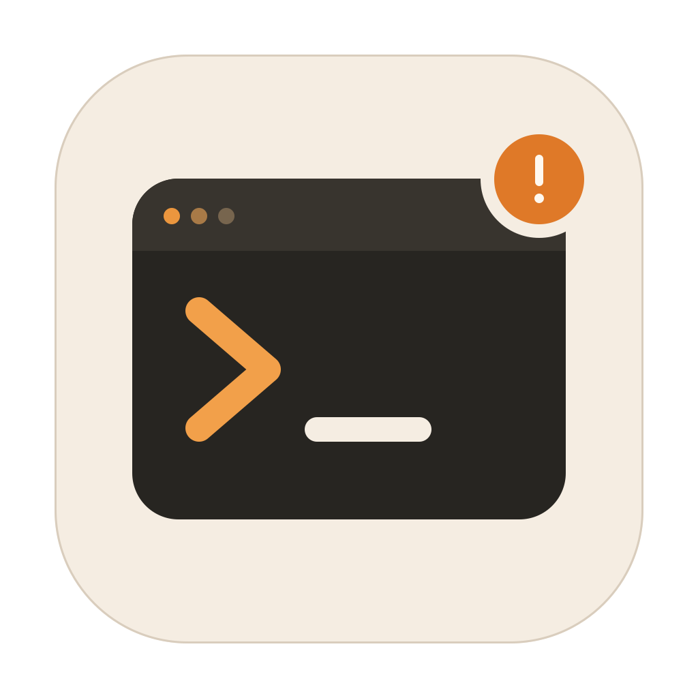

# Session Scout



A macOS menu bar app for keeping an eye on local Codex sessions. See which sessions are working, waiting for permission, or asking you a question, and jump back to review them.

## Setup and run

Requires **macOS 14+**, **Xcode 16+ / Swift 6**, and a current version of Codex with a local session open. Open Xcode once to finish setup, and select its command-line tools under **Settings → Locations**.

```sh
git clone https://github.com/huangjoseph45/Codex-Watcher.git
cd Codex-Watcher
bash scripts/run-app.sh
```

This **builds and launches** the app, replacing any running copy. No extra packages are needed.

Look for the **lookout flag in the menu bar**—there is no Dock icon or main window. If you cannot see it, check whether other menu items or the display notch are hiding it. Sessions refresh every **15 seconds** by default.

For later launches, open `dist/Session Scout.app` in Finder, or copy it to Applications. To rebuild after source changes, rerun the launch script. To build without launching, use `bash scripts/build-app.sh`.

## Everyday use

- **Click the flag** to see active sessions, their folders, and live status.
- **Click a session** to open its VS Code project. This targets the project window, not an exact terminal tab. Other sessions offer a chooser of running terminal/editor apps; choose the app, then select the session’s tab or window. You can also copy its session ID.
- **Folder** selects a custom Codex home directory. The default is `~/.codex`; shell launches also honor `CODEX_HOME`.
- **Refresh** scans immediately. The **Settings** tab contains popup preferences, sounds, volume, refresh interval, and the Codex home folder. Enable or disable permission popups, questions that pause Codex, and questions asked while Codex continues working independently. **Show automatic popups** turns them all off without changing those individual choices. **Sessions → Review requests** still opens pending prompts manually. Preferences are saved across relaunches.
- **Power** quits the app. Right-click a session to copy its ID or folder path.

## Permissions and questions

Permission requests open a dedicated approval popup. A small popup announces other requests that need your attention. **Review** opens the details; **Open session** takes you back to the session’s app for context. Popups do not require macOS notification permission.

Permission popups show the command, reason, working directory, and requested access. They offer Codex’s available choices: **Allow once**, **Allow for this session**, **Allow all commands of this type** (with the exact saved command prefix), network host rules, **Decline**, and **Cancel run**. Only choices supported by the request appear. Separate permission grants offer turn or session scope. File approvals show the proposed diffs and allow approval here when those details are available. Cancel run interrupts the current run; it does not undo completed changes. **Later** dismisses the popup without responding. You can reopen it with **Review requests** in the dropdown.

Clarifying questions with supported choices or text fields can be answered in the popup. Asynchronous questions—such as choosing a design while Codex continues working—show a review-only popup with **Open session**. Unsupported forms and unavailable details offer this fallback. Long requests scroll inside the popup. No answers are chosen automatically.

Asynchronous questions remain marked for review until later user input or a new turn supersedes them. Detection depends on Codex exposing a structured question or waiting status; ordinary questions written only in chat prose are not inferred. File approvals with unavailable diffs still require the original session.

## Settings and limitations

Defaults live in [`config.json`](Sources/SessionMonitor/Resources/config.json). To customize them without rebuilding, copy it to `~/Library/Application Support/SessionScout/config.json`, edit it, and relaunch. Saved choices in Settings override the corresponding defaults. `SESSION_SCOUT_CONFIG` can point to another config file when launching from a shell.

Faster refresh means more database reads, local socket requests, and wakeups. A 1-second interval polls roughly 15 times as often as the default. Scans run in the background and never overlap; polling does not start AI turns.

Only **local** sessions with an active Codex writer lock are listed, including idle sessions. Remote sessions and older Codex versions without writer locks are unsupported. Codex’s database and local protocol are internal formats and may change. If live status is unavailable, the app shows **Unknown** rather than guessing.

The scanner reads Codex’s existing SQLite database and local server; it does not create a separate database or start another Codex server. Responses are sent only after an explicit click and a fresh check of the pending request. Local builds are ad hoc signed; distribution requires your own signing and notarization.

## Development

Open `Package.swift` in Xcode and run the `SessionScout` scheme, or use `swift run SessionScout`.

```sh
swift test
# Optional check against your running local sessions; sends no answers:
CODEX_WATCHER_LIVE_TEST=1 swift test --filter testLocalSessionSmokeCheckWhenRequested
```
